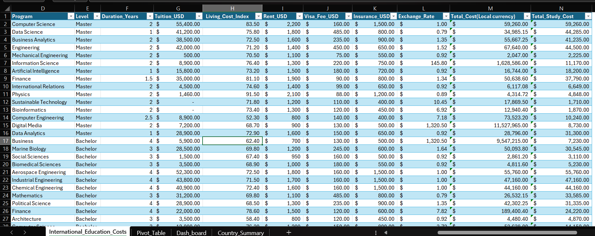
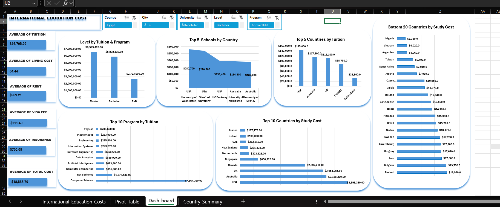

# International Education Costs — Cost-of-Study Comparison Across 71 Countries

> What does it really cost to study abroad, and where is it cheapest? An interactive **Excel** analysis of 907 programmes across 71 countries, with a formula bug found and fixed along the way.

---

## 1. Introduction

Choosing where to study abroad is one of the biggest financial decisions a student or family makes. Tuition is only part of the story: rent, visa fees and insurance all add up, and costs vary enormously between countries and between degree levels.

This project analyses **907 study programmes in 71 countries, 622 universities and 92 programmes** (Bachelor's, Master's and PhD). It combines tuition, rent, visa fees and insurance into one comparable cost per programme and presents it in an interactive Excel workbook with PivotTables, charts and slicers. While checking every figure against the raw data, I found and fixed a formula error in the "total cost" columns that was overstating every programme's cost.

---

## 2. Problem Statement

A prospective international student, an education consultancy, or a scholarship or loan provider needs to **compare the all-in cost of studying a given programme in a given country** (tuition, rent, visa and insurance combined) in order to budget accurately and compare destinations fairly.

Doing this by hand across 907 programmes and 71 countries is impractical, and the two columns labelled as the "total" in the source file turned out to be wrong, so anyone reading them at face value would budget against the wrong number.

**Questions this project answers:**
1. What is the average cost of studying abroad, and how does it break down?
2. Which countries are the cheapest and the most expensive?
3. How does cost differ between Bachelor's, Master's and PhD programmes?
4. Which programmes and universities cost the most?
5. Can a non-technical user filter all of this by country, city, university, programme or level without writing formulas?

---

## 3. Data Sourcing

- **Dataset:** one table of **907 programme records** with 14 columns (451 Master's, 297 Bachelor's and 159 PhD programmes).
- **Source:** [add where the dataset came from, e.g. the training provider or platform]
- **Currency:** US dollars, with an exchange rate column for each country.

| Group | Columns |
|---|---|
| Location and institution | `Country`, `City`, `University` |
| Programme | `Program`, `Level` (Bachelor, Master, PhD), `Duration_Years` |
| Costs | `Tuition_USD`, `Rent_USD`, `Visa_Fee_USD`, `Insurance_USD` |
| Cost-of-living and currency | `Living_Cost_Index` (a comparison score, not a dollar amount), `Exchange_Rate` |
| Derived totals | `Total_Study_Cost`, `Total_Cost(Local currency)` |

**How I defined total cost:** `Total_Study_Cost` = Tuition + Rent + Visa Fee + Insurance (all in USD). The Living Cost Index is kept as its own metric and is **not** added to the cost.

---

## 4. Tool I Used and Why

I used **Excel only**, and I built the three analysis sheets myself on top of the data sheet:

| Sheet | What it does |
|---|---|
| **International_Education_Costs** | The source data: 907 rows, with the corrected total-cost formulas |
| **Pivot_Table** | 15 linked PivotTables and 7 charts summarising cost and record counts by level, country, programme and university. The dashboard charts are built on the same data |
| **Dash_board** | The interactive dashboard: headline cards for the average tuition, living cost index, rent, visa fee, insurance and total cost, five slicers (Country, City, University, Level, Program) and six charts |
| **Country_Summary** | One row per country (71) showing the **average total study cost** and the number of programmes, using `AVERAGEIF` and `COUNTIF`. This answers the key question: which country is cheapest, all-in? |

**Why Excel was the right and only tool:**
- **Every question is an aggregation.** Totals and averages by country, level, university and programme are exactly what PivotTables do natively, with no code.
- **One table, no joins.** The data is a single clean table of 907 rows, so there was nothing for SQL to join, and no statistical testing or modelling that would call for Python.
- **Interactivity without formulas.** Slicers let a student or consultant filter the dashboard in a click. That's the core need, and Excel delivers it directly.
- **The audience already uses Excel.** Students, education consultancies and loan providers can open, check and reuse the workbook without installing anything.
- **Fully auditable.** Every figure traces back to the raw rows in the same file, with no separate summary tables to keep in sync.

---

## 5. Data Transformation and Cleaning

**Checks I ran:**
- **No missing values** and **no duplicate rows** across all 907 records.
- **Consistent categories:** all 71 country names and the three `Level` values are spelled consistently, with no case mismatches or stray variants.
- **Pivot accuracy:** I recomputed totals from the raw columns and compared them with the PivotTable totals. For example, tuition by level: Master 6,549,420, Bachelor 5,878,430 and PhD 2,723,600, a grand total of 15,151,450. All matched exactly.

**The main problem I found: a formula error in both "total" columns.**
- `Total_Study_Cost` was adding the **Living Cost Index** (a score between about 28 and 122, not money) into the dollar total. This overstated every programme by its own index score, an average of **$64.44** per row, or about 6% on the cheapest programme.
- `Total_Cost(Local currency)` converted **only the insurance** into local currency and left tuition, rent and visa fees in dollars, mixing two currencies in one sum. For a Data Analytics Master's in Tehran (exchange rate 42,150) it showed 11.8 million, when the correct figure is about 161 million rials ($3,830 × 42,150).

**What I did:**
- Rewrote `Total_Study_Cost` as **Tuition + Rent + Visa Fee + Insurance**.
- Rewrote `Total_Cost(Local currency)` as **(Tuition + Rent + Visa Fee + Insurance) × Exchange Rate**, so every component is converted together.
- Refreshed the PivotTables and charts. Those built on the individual cost columns were unaffected, and only the one summarising the total needed refreshing.
- Added the **Country_Summary** sheet so the all-in cost by country has a direct answer.

**The cleaned data sheet after the fix:**

In the screenshot, `Total_Study_Cost` (last column) now equals Tuition + Rent + Visa Fee + Insurance. For example, the first row is $55,400 + $2,200 + $160 + $1,500 = **$59,260**. `Living_Cost_Index` sits in its own column and is no longer part of the total.

**Other data issues noted:**
- **Garbled text:** 20 records have garbled accented characters in city or university names, for example "École Polytechnique" (should be École Polytechnique), "Tromsø" (Tromsø) and "Ã…s" (Ås). This is a text-encoding problem from how the file was saved. The names are still readable and don't affect any totals, but the fix is to re-save or import the source as UTF-8.
- **Zero tuition:** 103 programmes have $0 tuition (mostly in countries such as Germany, Greece and Denmark). I kept them, since they appear to be genuine tuition-free places.

---

## 6. Analytics and Measures

### Headline averages (per programme)
| Measure | Value |
|---|---|
| Average total study cost | **$18,586** |
| Average tuition | $16,705 |
| Average rent | $969 |
| Average visa fee | $211 |
| Average insurance | $700 |
| Average living cost index | 64.44 (an index, not a dollar amount) |

### Extremes
- **Cheapest programme:** $600, a PhD in Data Analytics at the National University of Cuyo, Argentina.
- **Costliest programme:** $66,160, a Master's in Economics at Columbia University, USA.

### By country (average total study cost, from `Country_Summary`)
| Most affordable | Average | Most expensive | Average |
|---|---|---|---|
| Argentina | $677 | USA | $51,261 |
| Greece | $1,312 | Australia | $37,072 |
| Algeria | $1,582 | Singapore | $36,457 |
| Sweden | $1,723 | UK | $32,846 |
| Finland | $1,815 | Canada | $31,542 |

### By degree level
| Level | Average total cost | Average duration |
|---|---|---|
| Bachelor | $21,772 | 3.5 years |
| PhD | $19,012 | 4.1 years |
| Master | $16,337 | 2.0 years |

Master's programmes are the cheapest level on average. Their average tuition per programme is also the lowest of the three (about $14.5K, vs $19.8K for Bachelor's and $17.1K for PhD). Master's tuition looks the biggest in total ($6.55M) only because the dataset has the most Master's records (451).

### Excel techniques used
PivotTables and PivotCharts, slicers linked across sheets, `AVERAGEIF` and `COUNTIF` (Country_Summary), cell formulas for the corrected totals, and Data → Refresh All to update the pivots after the fix.

> **Reading the dashboard rankings:** several dashboard charts rank by the **sum** across all programmes, so they reflect how many programmes a country or subject has as well as how costly it is. For example, the USA has 78 programmes and Nigeria has 1, and Computer Science has 312 of the 907 records. For a fair comparison of how expensive countries really are, use the **average** figures in `Country_Summary`.

---

## 7. Dashboard and Visuals

### Dashboard (`Dash_board` sheet)

- **Headline cards (left):** average tuition, living cost index, rent, visa fee, insurance and total cost, so the typical cost of each component is visible at a glance.
- **Slicers (top):** Country, City, University, Level and Program. They filter the linked charts and PivotTables.
- **Level by Tuition and Program:** total tuition for Master, Bachelor and PhD programmes.
- **Top 5 Schools by Country** and **Top 5 Countries by Tuition:** which universities and countries sit at the top for tuition.
- **Top 10 Program by Tuition:** the programmes with the largest total tuition.
- **Top 10 Countries by Study Cost** and **Bottom 20 Countries by Study Cost:** total study cost across all programmes in each country.

### Pivot_Table sheet
The 15 PivotTables and 7 charts behind the dashboard. They summarise tuition, rent, visa, insurance and record counts by level, country, programme and university.

### Country_Summary sheet
One row for each of the 71 countries, with the **average true total cost (USD)** and the **number of programmes**. It answers "which country is cheapest, all-in?" directly, and averages are a fairer comparison than totals.

---

## 8. Recommendation

1. **Use the corrected `Total_Study_Cost`** as the single source of truth for budgeting and country comparisons. It now reflects actual costs only.
2. **Keep the Living Cost Index as its own metric,** and label it clearly as an index (for example "Cost-of-Living Index, baseline = 100") so it is never read as a dollar amount again.
3. **Use Country_Summary for "which country is cheapest, all-in" questions.** Averages are the fair comparison, because totals mostly reflect how many programmes a country has in the dataset.
4. **Fix the text encoding** of the 20 garbled city and university names by re-importing the source as UTF-8.
5. **Next improvement:** adjust costs for programme duration (`Duration_Years`), since the current total adds tuition, rent, visa and insurance without scaling for how long the programme lasts.

**How to validate:** click any cell in `Total_Study_Cost` and confirm the formula contains no Living Cost Index. Then use Data → Refresh All, and check that the Tehran row reads $3,830 and that total tuition is still 15,151,450.

---

## 9. Conclusions

- **Where you study matters enormously.** The average total cost ranges from **$677 in Argentina to $51,261 in the USA**, a gap of about 75 times.
- **English-speaking destinations are the most expensive.** The USA, Australia, Singapore, the UK and Canada occupy the top five by average cost, while several European and South American countries are far cheaper.
- **Master's programmes are the cheapest level** on average ($16,337), ahead of PhD ($19,012) and Bachelor's ($21,772).
- **A hidden formula error changed every total.** Treating a cost-of-living index as dollars overstated every programme, and the currency conversion mixed two currencies. Auditing the formulas, and not just the numbers on screen, caught it before it could mislead budgeting decisions.
- **Limitation:** the total cost is a comparison measure. It adds tuition, rent, visa and insurance without scaling by programme length, so a duration-adjusted version would be more precise for actual budgeting.

---

*Prepared by Nwogbe Onyinyechi Victoria · Data Analyst*
